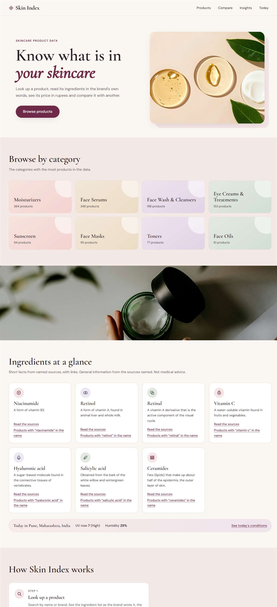
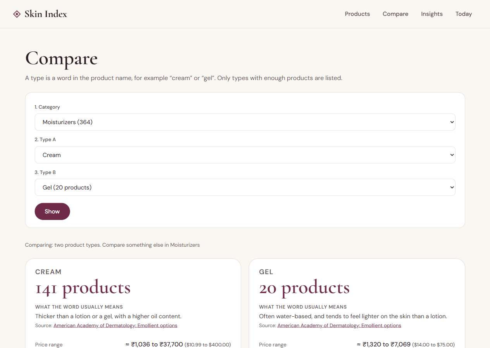
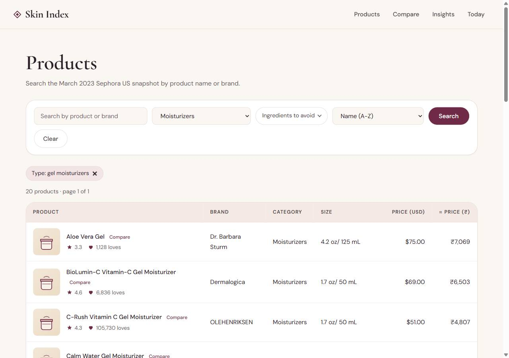

# Skin Index

A Flask app for exploring skincare products: ingredients, prices, comparisons and shopper-engagement numbers, with live pages for today's sun and air conditions and for ingredient science. It shows data and named sources. It never recommends a product.



## Features

- **Products** (`/products`): search by name or brand, category filter, sort, paging, prices in USD and approximate rupees, and "My avoid list" (hide products that list ingredients you want to avoid). A whole-word type filter (for example "Type: gel moisturizers", a removable chip) is reached from Compare types.
- **Compare products** (`/compare`, "Two specific products"): pick a category (any category with 2 or more products), optionally narrow by main ingredient, then pick two products. The table shows price, size, price per ml, likes, rating, reviews and the ingredients both have and only one has. No verdict.
- **Compare types** (`/compare`, "Two product types"): pick a category, then two types that are words in product names (for example cream vs gel). Types are read from the data by whole-word matching and only types with at least 15 products are offered. A name with both words counts on neither side. Each column shows the product count, price range, average rating and most common ingredients, plus a "See all N products" link to the matching Products list.
- **Insights** (`/insights`): the most liked brands and products (likes, ratings and reviews from one retailer's site, not sales), well-reviewed products with a lower price per ml, price vs rating bands, and the most common ingredients.
- **Today** (`/today`): live UV index, humidity, temperature and US air quality for a city (default Pune) from Open-Meteo, shown as information, with sun-protection guidance and weather tips quoted from named sources (American Academy of Dermatology, World Health Organization, Johns Hopkins Medicine).
- **Ingredient Science** (`/science`): PubMed papers about an ingredient as cards under plain labels, each with a "Read on PubMed" link, and an "At a glance" box with source-named ingredient cards. It lists papers only.

| Compare types | Products filtered by type |
|---|---|
|  |  |

More screenshots (1280px wide, plus one phone view) are in [docs/screenshots/redesign](docs/screenshots/redesign): products, compare, insights, today, science, product detail and the home page on a phone.

## Safety principle

Skin Index informs and never recommends.

- Data and named sources only. No product is called better, best, right or suitable for anyone, and there are no skin-type or skin-concern claims.
- Fixed texts live in `content/*.py` and are checked by tests for banned wording (for example safe, best, recommended, treats, cures, proven, effective). Guidance and tips are quoted from the sources named next to them.
- "Not found" is never shown as "safe": an avoid-list check with no match only says nothing on the list was found.
- Pages that show ingredients carry a patch-test and see-a-dermatologist note, and "General information from the sources named. Not medical advice."
- The avoid list stays in the visitor's browser (a cookie their own action sets). The server reads it to filter and tag one response and never saves, logs or links it.

## Data and sources

- **Products:** a March 2023 Sephora US snapshot (`data/product_info.csv`, not in the repo). Prices, likes, ratings and reviews are as of then, not live.
- **INR prices:** converted from the US prices at the daily USD to INR rate from [Frankfurter](https://frankfurter.dev) (no key). The rate is saved and fetched at most once a day; if it cannot be fetched the last saved rate is shown and marked "older rate", and with none saved INR is hidden. Rupee figures are approximate, not Indian retail prices.
- **Weather and air quality:** [Open-Meteo.com](https://open-meteo.com/) (free for non-commercial use), with air quality from CAMS and places from GeoNames. Cached for 15 minutes; if the service is down the page says so and shows no made-up numbers.
- **Papers:** PubMed (US National Library of Medicine). Searches are saved for 24 hours. To give NCBI a contact address, set the `NCBI_EMAIL` environment variable; with none set no email is sent.
- **Texture lines (cream, gel):** our own wording about texture, taken from the American Academy of Dermatology page "Emollient options". Other types show data only.
- **Ingredient strengths:** shown only when the brand printed them ("12.025% (stated by brand)"). A missing percentage means "not stated", not "low".
- **Ingredient names** are never merged: only Water, Aqua and Eau count as one, and so do Fragrance and Parfum.
- **Compare groups:** a product's group is the most specific category level in the data, tidied by the map in `content/compare_groups.py`. Before and after counts are in [docs/data-audit.md](docs/data-audit.md).

## Tech stack

Python, Flask, SQLite, pandas, plain HTML/CSS/JavaScript, pytest, and `requests` for the live data. All outside calls live in the `live/` package, with a timeout, a cache and a plain error message. Built with Claude Code.

## Run it locally (Windows PowerShell)

```
python -m venv venv
.\venv\Scripts\Activate.ps1
pip install -r requirements.txt
python -m database.load_data
python app.py
```

`database.load_data` needs `data/product_info.csv` and fills `skin_index.db`. Run it again whenever the loader or the group cleanup map changes. Then open http://localhost:5001. The first page load of the day needs internet for the exchange rate.

## Tests

```
pytest
```

There are 1,627 tests and all of them pass. They never use the real network: every `live/` call is replaced by a fake.

## My avoid list

On the Products page, open "Ingredients to avoid" in the filters, type an ingredient and press Add (or Enter). Each word or phrase becomes a removable chip, and "Clear my list" empties the list. Words are matched as whole words, ignoring capital letters, in the ingredient list as the brand wrote it, so "alcohol" finds "Cetyl Alcohol" but not "Alcoholic". The only synonyms are fragrance/parfum and water/aqua/eau.

- A row, the product page and the Compare page show a tag such as "Lists: fragrance, matched: Fragrance (Parfum)" when something is found. Nothing found says "None found in the listed ingredients". A product with no ingredient list says "Ingredient list not available, can't check" and is never treated as clear.
- "Hide products that list my avoided ingredients" removes matching products from the list; products that cannot be checked stay. It also works together with the type filter, paging and sorting.
- Privacy: the list is a cookie in your browser (30 days, up to 20 items). The site reads it with each request but does not save it, log it or put it in a link. There are no accounts.
- It is based on the brand's own ingredient list, which can be incomplete. Check the product label.

## MCP in this project

Four MCP servers were connected to Claude Code while building this project. **`skin-index` is the one I built; the other three are existing servers I connected.** Only `skin-index` is part of this repository's code.

| Server | Built by | What it is used for |
|---|---|---|
| `skin-index` | me, in this repo (`mcp_server/server.py`) | The project's own server: 9 read-only tools over the app's data, including `compare_types` |
| `skin-index-db` | existing server, connected | A read-only SQLite explorer for inspecting `skin_index.db` |
| GitHub MCP | existing server, connected | Repository work (it is the hosted GitHub server, connected over HTTP) |
| Playwright MCP | existing server, connected | A browser tool used for the UI redesign, the screenshots and the overflow checks |

### `skin-index`: the server I built

`mcp_server/server.py` (the official Python MCP SDK, FastMCP, stdio) lets Claude Code ask about the same data as the website. It only wraps the app's service functions, so it follows the same rules: it lists facts and numbers, never recommends a product, has no skin-type tool, and "none found" is never "safe". Every answer names its source, and bad input gives a plain error message. The product database is opened read-only. All nine tools are read-only; the one that saves anything is `find_studies`, which keeps PubMed paper lists for 24 hours in the `pubmed_searches` cache table, as the Ingredient Science page does.

| Tool | What it returns | Source named |
|---|---|---|
| `search_products` | Products by text in the name or brand, group and an ingredient word (whole words in the brand's ingredient text); up to 25, USD prices | March 2023 Sephora US snapshot |
| `get_product_detail` | One product: facts, likes, rating, reviews, ingredients in label order, strengths only when the brand printed them | March 2023 Sephora US snapshot |
| `compare_products` | Two products side by side when they are in the same group; otherwise says why not. No verdict | March 2023 Sephora US snapshot |
| `compare_types` | Two product types of one group: product counts, products with both words left out, USD price range, average rating, most common ingredients, a relative `products_path` to the matching Products list, and the texture line where a source was read. With no input or an unusable choice it returns a plain status and `valid_choices`. No verdict | March 2023 Sephora US snapshot |
| `get_insights` | Most liked brands and products (shopper engagement, not sales), overall or in one group | March 2023 Sephora US snapshot |
| `list_groups` | Group names with product counts | March 2023 Sephora US snapshot |
| `get_weather` | UV now and peak, humidity, temperature and US AQI for a city or coordinates, as information only; always names the place used | Open-Meteo, CAMS, GeoNames |
| `find_studies` | Up to 10 PubMed papers for "<ingredient> AND skin" (title, journal, year, kind of paper, link) | PubMed |
| `check_avoid_list` | Which of your words appear in one product's ingredient text, with the same matching as the site; the words are not stored | March 2023 Sephora US snapshot |

Connect it once, from the project folder (Windows PowerShell). Type this yourself; `--scope local` writes nothing to the repository:

```
claude mcp add --scope local --transport stdio skin-index -- "C:\HiralWork\Skincare\venv\Scripts\python.exe" "C:\HiralWork\Skincare\mcp_server\server.py"
```

Check it: start a new session with `claude` in this folder and run `/mcp`; `skin-index` should show as connected with 9 tools (outside a session, `claude mcp list` shows the same). To use another database file, set the `SKIN_INDEX_DB` environment variable. Remove it with `claude mcp remove skin-index --scope local`.

Example questions to ask Claude Code:

1. "Which comparison groups have the most products, and what are the most liked products in Face Serums?" (`list_groups`, `get_insights`)
2. "Compare cream and gel moisturizers by price range and average rating." (`compare_types`)
3. "Check product 1410 for fragrance and alcohol, then show the PubMed papers on niacinamide and today's UV in Pune." (`check_avoid_list`, `find_studies`, `get_weather`)

### `skin-index-db`: an existing read-only SQLite explorer

[mcp-sqlite-insights](https://github.com/RayaanKaz/mcp-sqlite-insights) lets Claude Code answer questions about `skin_index.db` in plain English (for example "count products per compare_group"). The app does not use it. It is pinned to one commit and installed in its own virtual environment under `tools/`, which is not committed. SQLite opens the file read-only, so a write is refused. That covers this server only; Claude Code's own shell and edit tools can still reach the file.

```
git clone https://github.com/RayaanKaz/mcp-sqlite-insights.git tools/mcp-sqlite-insights
git -C tools/mcp-sqlite-insights checkout 0f36dbc01923b67c45cf90a3dcbf658cc54b5be9
python -m venv tools/mcp-sqlite-insights/.venv
tools/mcp-sqlite-insights/.venv/Scripts/python.exe -m pip install -r tools/mcp-sqlite-insights/requirements.txt
tools/mcp-sqlite-insights/.venv/Scripts/python.exe tools/mcp-sqlite-insights/server.py --check
claude mcp add --scope local --transport stdio skin-index-db -- tools/mcp-sqlite-insights/.venv/Scripts/python.exe tools/mcp-sqlite-insights/server.py --db skin_index.db
```

It has two tools, `inspect_schema` and `execute_query` (one SELECT at a time, at most 50 rows). Remove it with `claude mcp remove skin-index-db --scope local`, then delete `tools/mcp-sqlite-insights`. The first findings from using it are in [docs/data-audit.md](docs/data-audit.md).

### Playwright MCP: an existing browser tool

The Playwright MCP server (`npx @playwright/mcp@latest`) lets Claude Code open the running app in a browser. It was used for the UI redesign, to take the screenshots in `docs/screenshots` and to check the pages for horizontal overflow at 1280px and 390px. The app does not use it.

```
claude mcp add --scope local playwright -- npx @playwright/mcp@latest
```

### GitHub MCP: an existing server for repository work

The GitHub MCP server is GitHub's hosted server (`https://api.githubcopilot.com/mcp/`, HTTP), connected to Claude Code for repository work. Nothing in this repository depends on it.
